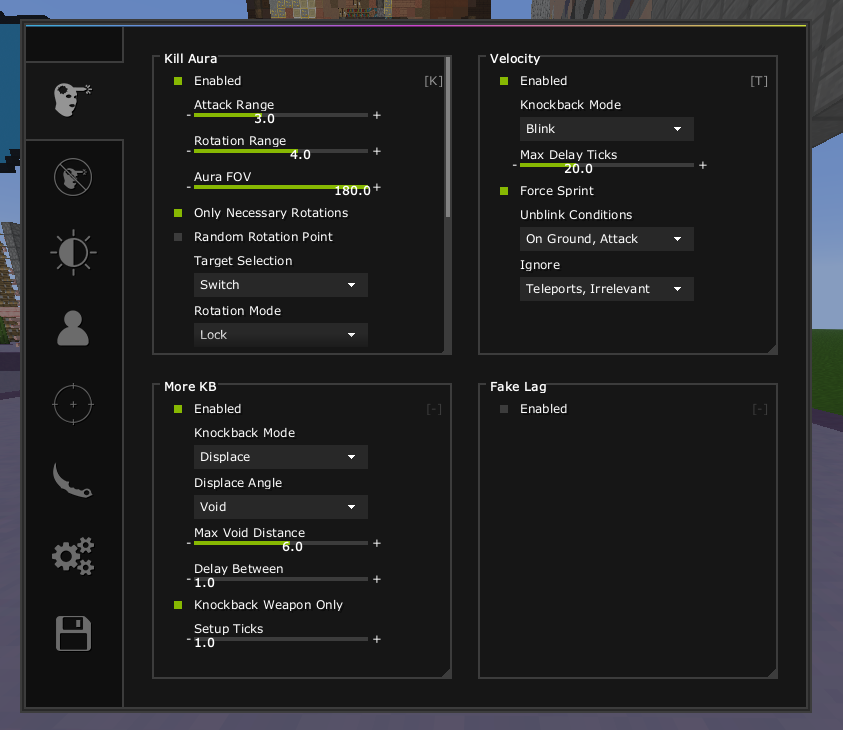
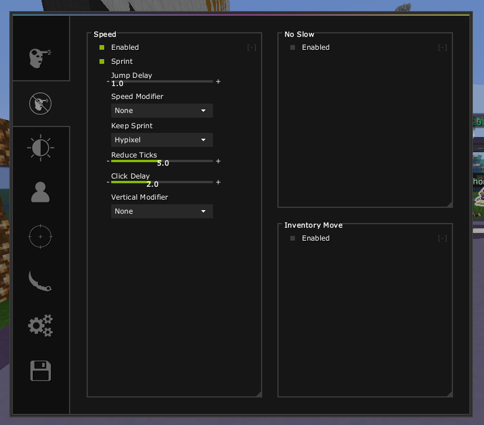
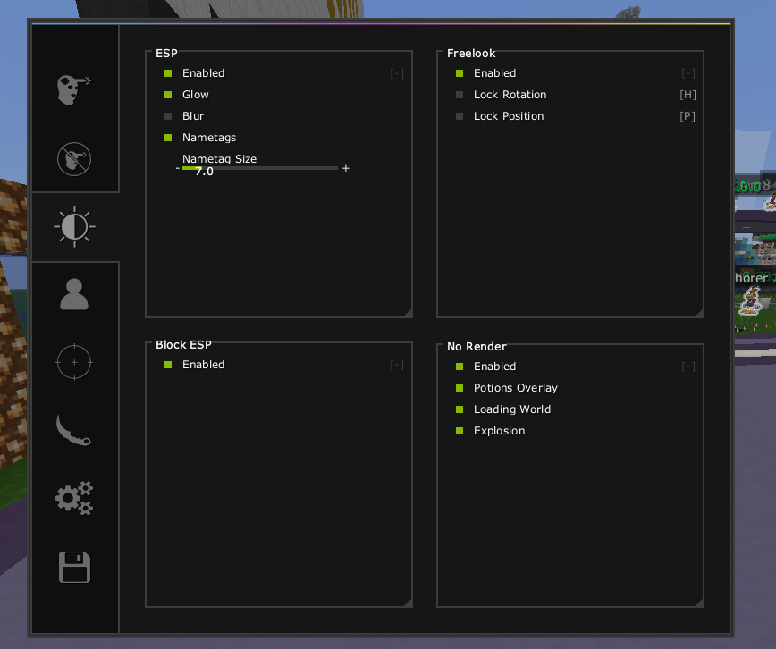
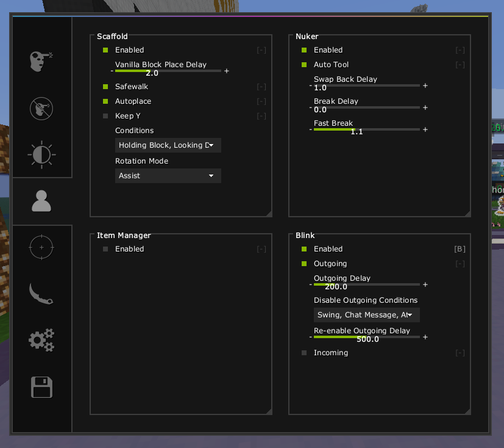
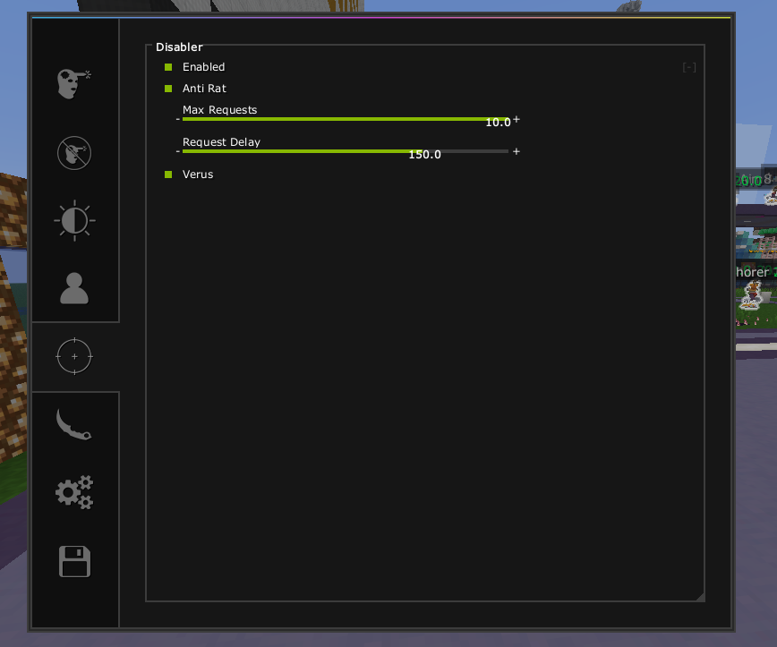
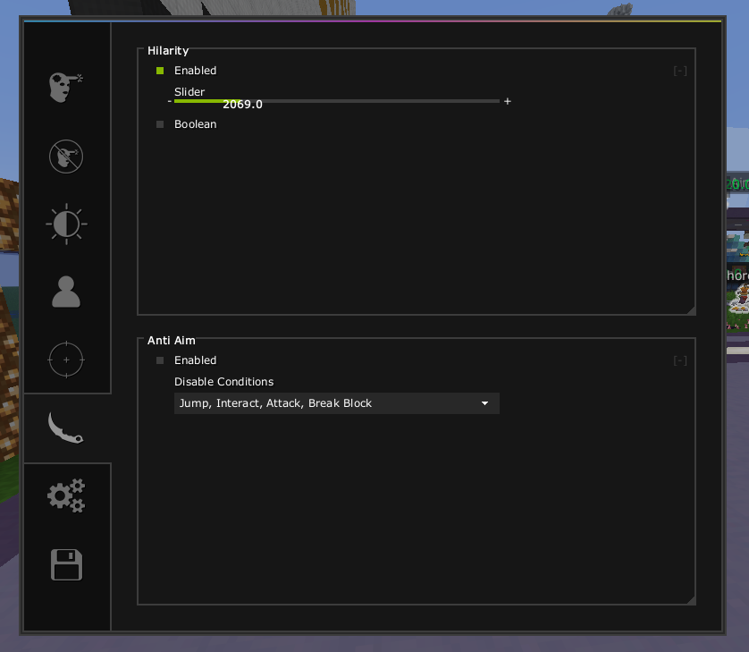
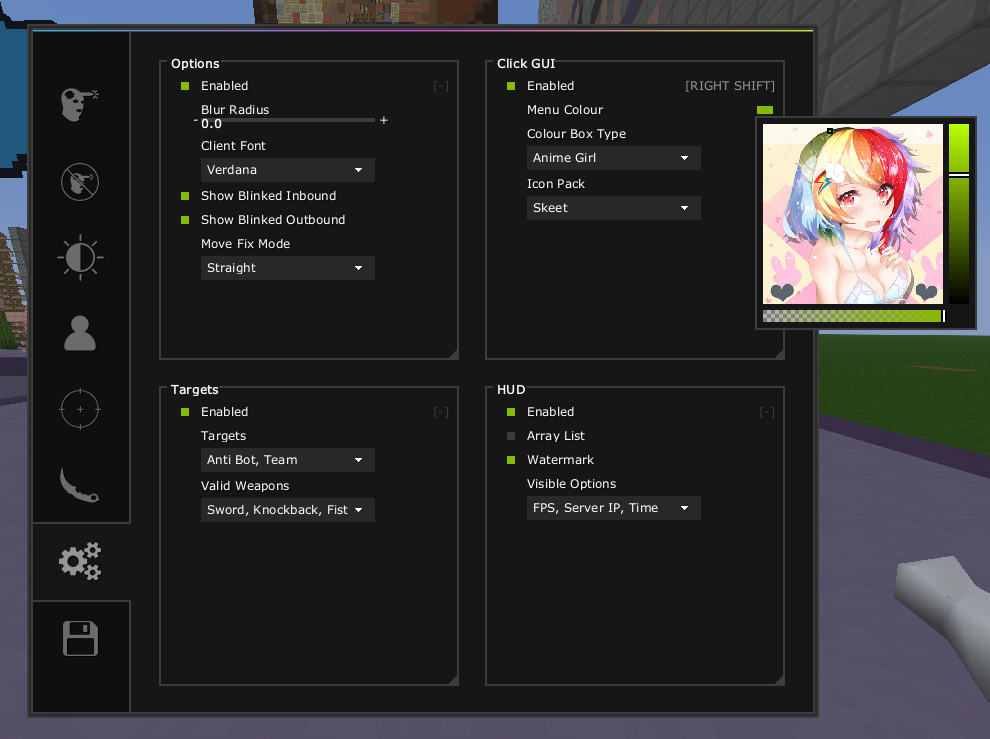
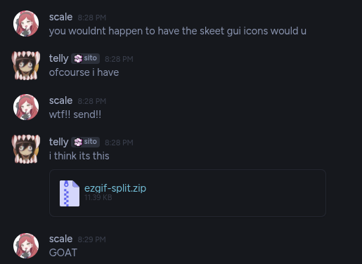

# ScaleHack v4
A 1.21.11 fabric cheat for Minecraft.
Made to bypass hypixel after the "new" prediction anticheat.
Never really finished or tested it, but hypixels anticheat was terrible as of September 2026, so bypasses for everything is simple </3

## Showcase
https://www.youtube.com/watch?v=8TAtuj0n5o0
Yeah that the only video i have of the last build, gg

## Main menu

## Alt manager

You can [drag and drop](https://github.com/scoliossis/ScaleHackV4/blob/master/src/main/java/com/scale/scalehackv4/utils/alts/DroppedFileListener.java)
both
[localts alts](https://github.com/scoliossis/ScaleHackV4/blob/master/src/main/java/com/scale/scalehackv4/utils/alts/AltManagerUtil.java#L44) 
and
[cookie alts](https://github.com/scoliossis/ScaleHackV4/blob/master/src/main/java/com/scale/scalehackv4/utils/alts/CookieAltUtil.java)
which i think is swag!

### Issues
- Alt manager "Add account" button doesn't work when alt manager is expanded
- The little arrow looks ugly
- The Add Account button is only for microsoft oauth

## GUI

## Features
- Killaura [[Video](https://youtu.be/eFRzp8oiYDQ)], which hasnt got anything particularly cool, it does look for the closest possible rotation and works when theres walls in the way, which ig is cool
- Velocity [[Video](https://www.youtube.com/watch?v=FQH_XiEhoHU)], idk if it still bypasses, but it should for a while
- Keepsprint [[Video](https://youtu.be/6xTQvKAXBCM)], wow, idk if it still bypasses hypixel, probably does
- [KB displace](https://github.com/scoliossis/ScaleHackV4/blob/master/src/main/java/com/scale/scalehackv4/modules/impl/combat/MoreKbModule.java) named "More KB" in the gui, shrug
- [Blink](https://github.com/scoliossis/ScaleHackV4/blob/master/src/main/java/com/scale/scalehackv4/modules/impl/player/BlinkModule.java) i think its a really cool module, you can set the delay for receiving/sending packets, and set conditions for when to stop blinking and for how long to disable, works as fake lag
- [Scaffold](https://github.com/scoliossis/ScaleHackV4/blob/master/src/main/java/com/scale/scalehackv4/modules/impl/player/ScaffoldModule.java) has a god bridge, snap, telly and assist mode. works pretty well, doesnt have particularly smooth rots, but all modes except snap work infinite on hypixel as of september 2026
- "[Nuker](https://github.com/scoliossis/ScaleHackV4/blob/master/src/main/java/com/scale/scalehackv4/modules/impl/player/NukerModule.java)" didnt actually get to adding nuker, is a fastbreak and autotool module
- [Freelook](https://github.com/scoliossis/ScaleHackV4/blob/master/src/main/java/com/scale/scalehackv4/modules/impl/render/Freelook.java) also has freecam built in, both can be binded separately
- [No Render](https://github.com/scoliossis/ScaleHackV4/blob/master/src/main/java/com/scale/scalehackv4/modules/impl/render/NoRender.java), makes worlds load MUCH faster, hides explosion particles (for back when this was a skyblock cheat) and hides the potions gui
- Block ESP [[Image](repo/bed%20esp.png)] only bed esp, but easy to make it work for other blocks. shows the weakest adjacent block in the ESP aswell
- [Disabler](https://github.com/scoliossis/ScaleHackV4/blob/master/src/main/java/com/scale/scalehackv4/modules/impl/other/DisablerModule.java) has a larp verus disabler (hides the messages from chat) and a "anti rat" which rate limits the join api
- [Hilarity](https://github.com/scoliossis/ScaleHackV4/blob/master/src/main/java/com/scale/scalehackv4/modules/impl/fun/Hilarity.java) sends fake messages in chat from admins, i think its funny
- Anti Aim [[Video](https://www.youtube.com/watch?v=5lkm_gdgpUA)] makes ur body SHAKE VIOLENTLY
- Various client modules, Arraylist, watermark, clickgui, movefix, display real server position through blink, antibot, teams check.

Not exactly a finished client, feel free to finish it, i wont

#### Thanks telly for the skeet icons <3
